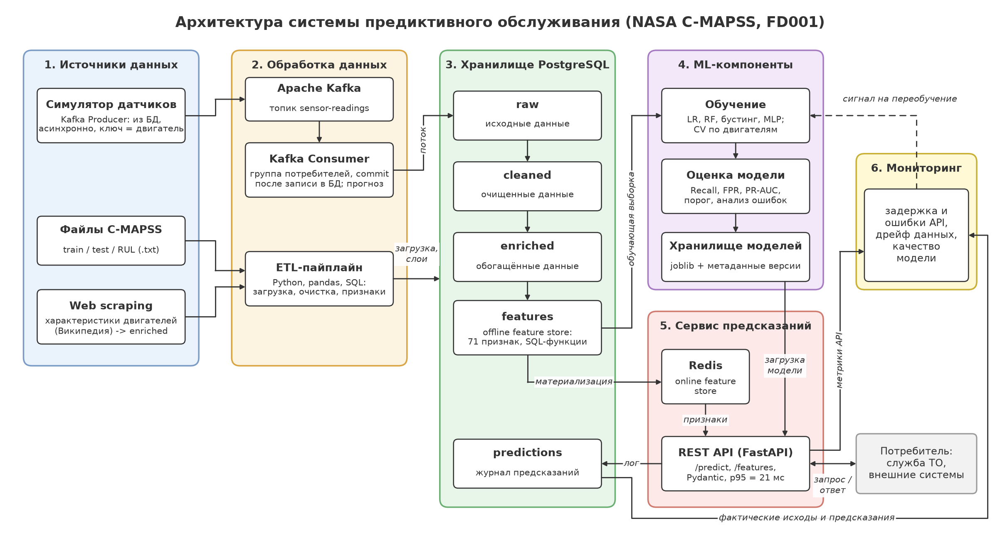

# Предиктивное обслуживание турбовентиляторных двигателей

Итоговая аттестация курса «Инженер-архитектор в сфере искусственного интеллекта», вариант Б «Производство».

Система по показаниям датчиков заранее предупреждает, что двигатель откажет в ближайшие **30 циклов работы**
(≈ 7 дней при 4 полётах в сутки — допущение проекта). Это позволяет планировать ремонт, а не устранять
внезапные отказы и не менять исправные узлы по регламенту.

**Данные:** NASA C-MAPSS (Turbofan Engine Degradation Simulation), поднабор FD001 — 100 двигателей в обучающей части
(наблюдения до отказа) и 100 в тестовой (наблюдения обрываются, истинный остаточный ресурс известен),
21 датчик и 3 режимных параметра на каждый цикл.

## Результаты

Финальная модель **v2** — логистическая регрессия на 71 признаке по истории двигателя. Порог тревоги
выбран по обучающей выборке так, чтобы нижняя граница 95% доверительного интервала Recall была ≥ 0,85.

| Требование | Кросс-валидация (train) | Тестовая выборка | Выполнено на test |
|---|---|---|---|
| Recall ≥ 0,85 | 0,874 | **0,714** (95% ДИ 0,59–0,80) | ❌ нет |
| False Positive Rate < 0,15 | 0,002 | 0,001 | ✅ |
| Время ответа API, p95 < 50 мс | — | 21 мс (1000 запросов) | ✅ |
| Доля отказов, предупреждённых заранее | 100 из 100 | 21 из 25 (84%) | — |
| Медиана запаса времени до отказа | 27 циклов | 26 циклов | — |

- **Почему Recall на test ниже требования.** Модель уверенно распознаёт близкий отказ (Recall 0,98–1,00
  при остатке до 20 циклов), но хуже — за 21–30 циклов. В тестовой выборке таких строк 63% (в обучающей — 32%),
  потому что наблюдения тестовых двигателей обрываются до отказа. Порог по тестовым данным не подбирался,
  чтобы оценка оставалась честной; рекомендация — уточнять порог в теневом режиме на реальных данных.
- **Бизнес-эффект.** По сравнению с заменой по возрасту (тревога с 146-го цикла) модель при том же Recall даёт
  в 95 раз меньше ложных тревог (13 против 1 240), условная стоимость ошибок (пропуск : ложная тревога = 10 : 1)
  ниже на 56%.

### Сравнение алгоритмов (PR-AUC, 10 блоков кросс-валидации по двигателям)

| Модель | PR-AUC | Время предсказания одной строки, p95* |
|---|---|---|
| **Логистическая регрессия** | **0,9932 ± 0,0031** | 5,8 мс |
| Нейросеть (MLP) | 0,9914 ± 0,0021 | 1,7 мс |
| Градиентный бустинг | 0,9907 ± 0,0056 | 7,5 мс |
| Random Forest | 0,9840 ± 0,0078 | 41 мс |

\* Замер во время подбора моделей, компьютер был нагружен; на свободной машине логистическая регрессия — ≈ 2 мс.

### Гипотезы ([docs/block1_analysis.md](docs/block1_analysis.md))

| | Гипотеза | Итог |
|---|---|---|
| H1 | Признаки по скользящему окну лучше исходных показаний | ✅ подтверждена: PR-AUC 0,954 → 0,993, p = 0,001 |
| H2 | Градиентный бустинг лучше логистической регрессии | ❌ не подтверждена: p = 0,98 |
| H3 | Финальная модель выполняет требования на отложенных двигателях | ❌ не подтверждена: Recall 0,59–0,80 |
| H4 | Время ответа p95 < 50 мс | ✅ подтверждена: 21 мс |

## Архитектура



```
Файлы C-MAPSS ──► ETL ──► PostgreSQL: raw → cleaned → enriched → features ──► обучение ──► models/final_v2.joblib
                                                                                                │
Показания датчиков (цикл за циклом) ──► FastAPI /predict ──► история двигателя ──► признаки ──► модель
                                               │
                                               └──► журнал monitoring.predictions (PostgreSQL)
```

Слои данных — отдельные схемы PostgreSQL:

| Схема | Содержимое |
|---|---|
| `raw` | Данные как есть из файлов, без ограничений уникальности |
| `cleaned` | После проверок: без дублей и ошибочных строк, без 8 неинформативных столбцов |
| `enriched` | + остаточный ресурс (RUL), целевая переменная, признак последнего цикла |
| `features` | 71 признак: для 14 датчиков — значение, среднее и разброс за 10 циклов, тренд за 20 циклов, отклонение от нормы первых 10 циклов. Окна только по прошлому — утечки из будущего нет |
| `monitoring` | Журнал предсказаний API |

Признаки считаются в SQL ([sql/layers.sql](sql/layers.sql)) для обучения и на Python
([src/data/features.py](src/data/features.py)) для онлайн-режима; тест проверяет, что результаты совпадают.

## Структура репозитория

```
├── api/                    FastAPI-сервис: эндпоинты, схемы валидации, история двигателей, журнал
├── data/
│   ├── raw/                исходные файлы FD001
│   ├── processed/          промежуточные данные (не хранятся в git)
│   └── samples/            пример слоя features
├── docs/                   анализ требований и гипотезы, архитектура, графики, замер задержки
├── models/                 финальная модель, baseline, результаты выбора модели
├── notebooks/
│   ├── 01_data_preparation.ipynb   загрузка, EDA, очистка
│   ├── 02_baseline_model.ipynb     baseline v1
│   ├── 03_model_selection.ipynb    три алгоритма, подбор гиперпараметров, H1 и H2
│   └── 04_final_model.ipynb        финальная модель, тест, H3, сравнение с регламентом
├── scripts/                диаграмма архитектуры, замер времени ответа API
├── sql/
│   ├── schema.sql          схемы слоёв, таблицы raw и журнала
│   ├── layers.sql          слои enriched и features (генерируется из src/data/features.py)
│   └── queries.sql         аналитические и контрольные запросы
├── src/
│   ├── data/               загрузка, очистка, признаки
│   ├── models/             метрики, кросс-валидация, обучение, сохранение и загрузка модели
│   ├── utils/              подключение к БД
│   └── etl_pipeline.py     ETL одной командой
├── tests/                  unit- и интеграционные тесты
├── streaming/, deployment/ Kafka и Docker — в работе (см. «Статус»)
└── requirements.txt        зависимости с точными версиями
```

## Запуск (Windows, PowerShell, без Docker)

Нужны Python 3.12 и PostgreSQL (проверено на 17). Права администратора не требуются.

**1. Окружение**

```powershell
git clone <адрес репозитория>
cd predictive-maintenance
python -m venv .venv
.\.venv\Scripts\python.exe -m pip install -r requirements.txt
```

**2. База данных.** Создать пользователя и базу (выполняется один раз под администратором PostgreSQL):

```sql
CREATE ROLE pdm LOGIN PASSWORD 'ваш_пароль';
CREATE DATABASE pdm OWNER pdm ENCODING 'UTF8' TEMPLATE template0;
```

Скопировать шаблон параметров и вписать пароль:

```powershell
Copy-Item .env.example .env
notepad .env
```

**3. ETL** — загрузка файлов и построение всех слоёв (≈ 1 минута):

```powershell
.\.venv\Scripts\python.exe -m src.etl_pipeline
```

В конце выводятся проверки качества (одинаковое число строк во всех слоях, 0 пропусков в признаках) и `Готово`.

**4. Обучение** (необязательно — обученные модели уже лежат в `models/`):

```powershell
.\.venv\Scripts\python.exe -m src.models.train_baseline     # baseline v1, ≈ 1 мин
.\.venv\Scripts\python.exe -m src.models.train_candidates   # три алгоритма с подбором, ≈ 30 мин
.\.venv\Scripts\python.exe -m src.models.train_final        # финальная модель v2, ≈ 1 мин
```

**5. API**

```powershell
.\.venv\Scripts\python.exe -m uvicorn api.main:app --port 8000
```

Интерактивная документация: <http://127.0.0.1:8000/docs>. Пример запроса из второго окна PowerShell:

```powershell
$body = '{"unit_id":1,"cycle":1,"s_2":641.82,"s_3":1589.7,"s_4":1400.6,"s_7":554.36,"s_8":2388.06,
"s_9":9046.19,"s_11":47.47,"s_12":521.66,"s_13":2388.02,"s_14":8138.62,"s_15":8.4195,"s_17":392,
"s_20":39.06,"s_21":23.419}'
Invoke-RestMethod http://127.0.0.1:8000/predict -Method Post -Body $body -ContentType 'application/json'
```

Ответ:

```json
{"unit_id": 1, "cycle": 1, "probability": 1.27e-08, "alarm": false, "threshold": 0.9721,
 "model_version": "v2", "history_cycles": 1, "warnings": ["short_history"], "latency_ms": 5.9}
```

| Эндпоинт | Назначение |
|---|---|
| `POST /predict` | Показания двигателя за цикл → вероятность отказа в 30 циклов, тревога, предупреждения |
| `GET /health` | Состояние сервиса и версия модели |
| `GET /model` | Порог, метрики, версии библиотек |
| `DELETE /engines/{unit_id}` | Сброс истории двигателя (после ремонта) |

Правила: циклы двигателя подаются по порядку с 1 (пропуск или повтор → `409` с ожидаемым номером цикла);
14 датчиков модели обязательны; `NaN`, бесконечность, отрицательные значения и неизвестные поля → `422`.
Предупреждения: `short_history` (циклы 1–5, тренд ещё неустойчив) и `out_of_range:<датчик>` (значение вне
диапазона обучающих данных — признак дрейфа).

Переменные окружения: `PDM_MODEL_NAME` (по умолчанию `final_v2`), `PDM_PREDICTION_LOG` (`db` или `none`).

**6. Тесты**

```powershell
.\.venv\Scripts\python.exe -m pytest -v
.\.venv\Scripts\python.exe -m pytest --cov=src --cov=api     # с покрытием
```

73 теста, покрытие 74%. Интеграционные тесты (помечены `integration`) используют PostgreSQL и
автоматически пропускаются, если база недоступна.

**7. Замер времени ответа** (сервис должен быть запущен):

```powershell
.\.venv\Scripts\python.exe scripts\benchmark_api.py
```

## Принятые решения

- **Разбиение по двигателям** (GroupKFold) везде — циклы одного двигателя зависимы, разбиение по строкам
  дало бы утечку данных.
- **PR-AUC** — основная метрика сравнения (дисбаланс классов: 15% положительных строк), F2 — вспомогательная.
- **Порог с запасом** вместо 0,5: наибольший порог, при котором нижняя граница 95% бутстрап-ДИ Recall
  (выборка двигателей с возвращением) ≥ 0,85.
- **Тестовая выборка** использована один раз — для финальной модели; модель и порог выбирались только по train.
- **Выбросы не удаляются**: 73% строк с выбросами приходятся на последние 30 циклов — это сигнал износа.
- `random_state=42` во всех случайных процедурах; точные версии библиотек — в `requirements.txt`
  и в метаданных модели `models/final_v2.json` (вместе с MD5 исходных файлов).

## Ограничения

- Данные симуляционные: один режим работы и один тип отказа; переносимость на реальный парк не проверялась.
- 30 циклов ≈ 7 дней и соотношение стоимости ошибок 10 : 1 — допущения, а не измеренные величины.
- Гиперпараметры подбирались на той же обучающей выборке, на которой сравнивались модели (без вложенной
  кросс-валидации), — оценки кандидатов могут быть слегка завышены. На выбор это не повлияло: кандидаты
  не обошли baseline, у которого гиперпараметры не подбирались.
- История двигателей в API хранится в памяти процесса: при перезапуске она теряется, а несколько копий
  сервиса не разделяют её. Перенос в Redis — в плане (блок 4.1).

## Статус

| Блок | Содержание | Статус |
|---|---|---|
| 1 | Требования, архитектура, гипотезы и план A/B-теста | ✅ |
| 2 | Загрузка в PostgreSQL, EDA, очистка, слои данных | ✅ |
| 3 | Baseline, три алгоритма с подбором гиперпараметров, финальная модель | ✅ |
| 4.1 | Feature Store: PostgreSQL + Redis, web scraping | ⏳ ожидает Docker |
| 4.2 | Kafka: producer и consumer с фиксацией смещения после записи в БД | ⏳ ожидает Docker |
| 5.1 | FastAPI с валидацией и тестами | ✅ |
| 5.2 | Docker и Docker Compose | ⏳ ожидает Docker |
| 6.1 | Тесты, покрытие > 60% | ✅ 74% |
| 6.2 | Документация | ✅ этот README |

## Технологии

Python 3.12 · pandas 3.1 · scikit-learn 1.9 · SQLAlchemy 2.1 · PostgreSQL 17 · FastAPI 0.165 · Pydantic 2.14 ·
pytest 9.2 · Jupyter
